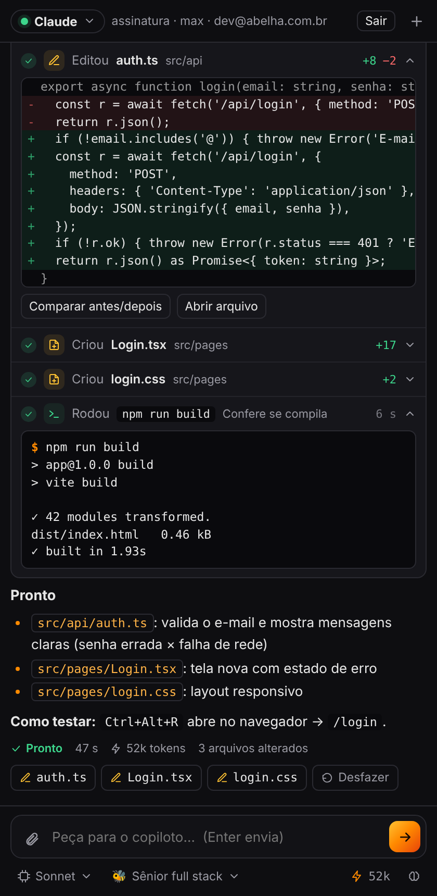
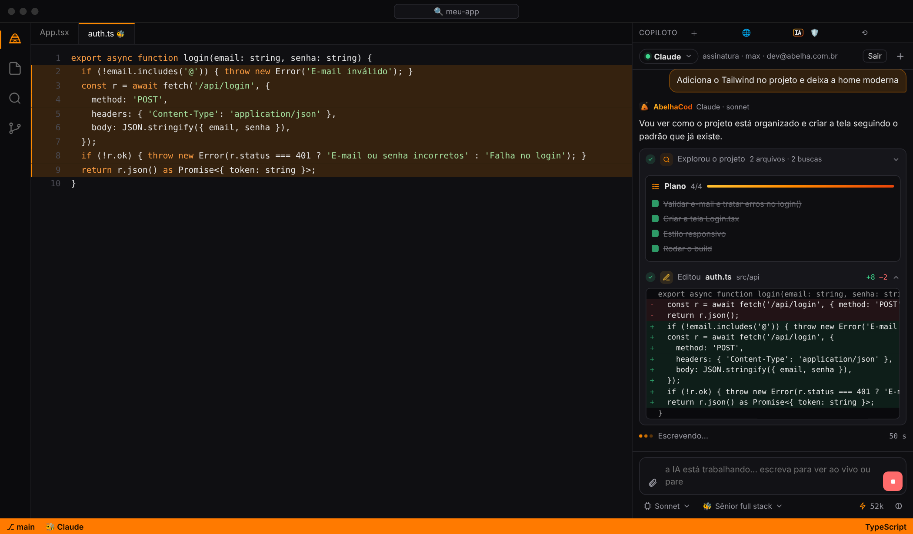

<h1 align="center">AbelhaCod</h1>

<b>O editor de código com inteligência artificial que programa junto com você — e você vê tudo acontecendo ao vivo.</b> 
Claude · Gemini · Grok · Meta AI · IAs grátis — em português, para Windows e Mac

Desenvolvido por <b>Othon Righetti</b> · CEO <b>ABELHA SOLUÇÕES</b> · CNPJ 50.891.115/0001-91

## ⬇️ Baixar

Vá em **[Releases › última versão](../../releases/latest)** e baixe o arquivo do seu computador:

| Seu computador | Baixe |
|---|---|
| **Windows 10 / 11** | `AbelhaCodSetup-x64-<versão>.exe` — instalador (recomendado) |
| Windows sem instalar (portátil) | `AbelhaCod-win32-x64-<versão>.zip` |
| **Mac com chip Apple (M1, M2, M3, M4)** | `AbelhaCod-macOS-arm64-<versão>.dmg` |
| **Mac com processador Intel** | `AbelhaCod-macOS-x64-<versão>.dmg` |

**Primeira vez no Mac:** arraste o AbelhaCod para *Aplicativos* e abra em **Ajustes do Sistema › Privacidade e Segurança › Abrir Mesmo Assim**.
Se aparecer que o app está "danificado", abra o Terminal e rode: `xattr -dr com.apple.quarantine /Applications/AbelhaCod.app`

 

## ✨ O que o AbelhaCod faz

**Uma IA que trabalha de verdade no seu projeto**
- Cria telas, páginas, APIs e apps completos; corrige bugs; explica código; escreve testes — direto nos seus arquivos.
- Você escolhe a IA: **Claude** (pela sua assinatura), **Gemini** (conta Google), **Grok**, **Meta AI** — ou o **Chat Grátis**, que funciona sem pagar nada.
- Escolha também o **modelo** (do mais rápido ao mais inteligente) direto no chat.

**Você acompanha tudo ao vivo**
- O arquivo que a IA está editando abre na sua frente, com as linhas novas destacadas.
- Abriu uma aba sua? A IA não mexe mais na sua tela. Terminou? As abas dela fecham sozinhas.
- No chat, cada passo aparece organizado: arquivos lidos, edições com o que entrou e saiu, comandos com o resultado e o plano da tarefa.

**12 agentes especialistas**
Sênior full stack, front-end, back-end e APIs, mobile (Android, Flutter, iOS), banco de dados, DevOps e nuvem, cibersegurança, testes, design e UX, dados e IA, jogos e revisor de código.

**Segurança e controle**
- Antes de instalar algo ou rodar um comando fora da rotina, o AbelhaCod mostra **o que vai acontecer e se é perigoso** — você decide.
- **Desfazer tudo:** antes de cada pedido é salvo um ponto de restauração; volte no tempo com um clique.
- **Memória do projeto:** a IA lembra o que já foi feito e não estraga o que já funciona.
- **Varredura de segurança** do projeto (senhas no código, injeção de SQL, XSS e mais) com correção automática.

**Produtividade**
- **Corrigir até passar:** roda os testes, a IA corrige, roda de novo… até dar certo.
- **Testar no navegador** com um atalho.
- **Uso de tokens** sempre visível, com dicas para economizar.
- **Git sem dor de cabeça:** diagnóstico que encontra e corrige problemas de conexão e login.
- Cole **prints** direto no chat, tema **claro e escuro**, tutorial com imagens na primeira abertura.

**Chat Grátis**
Várias IAs gratuitas já integradas. Se uma estiver ocupada, o AbelhaCod passa para a próxima sozinho, sem perder a conversa.

 

## ⌨️ Atalhos

| Atalho | O que faz |
|---|---|
| `Ctrl+Alt+A` | Abrir o Copiloto |
| `Ctrl+Alt+G` | Abrir o Chat Grátis |
| `Ctrl+Alt+I` | Trocar de IA |
| `Ctrl+Alt+S` | Salvar um ponto de restauração |
| `Ctrl+Alt+Z` | Desfazer o que a IA fez (voltar a um ponto) |
| `Ctrl+Alt+R` | Testar no navegador |
| `Ctrl+Alt+F` | Corrigir até passar |
| `Ctrl+Alt+V` | Varredura de segurança |
| `Ctrl+Alt+T` | Tema claro / escuro |

No Mac, use `Cmd` no lugar de `Ctrl`.

---

### 💬 Suporte

Alguma IA ou modelo falhou, deu erro ou travou? **Fale com a gente: (85) 98414-6479 — Suporte AbelhaCod.**
Dica: no **Chat Grátis**, o botão **Testar** confere do seu computador quais IAs estão respondendo agora; o modo **Automático** passa a evitar as que falharem.

© 2026 Othon Righetti — ABELHA SOLUÇÕES (CNPJ 50.891.115/0001-91). Todos os direitos reservados.
Os instaladores são gratuitos para uso. O código-fonte do AbelhaCod não é público. Baseado no Code - OSS (licença MIT, Microsoft).
