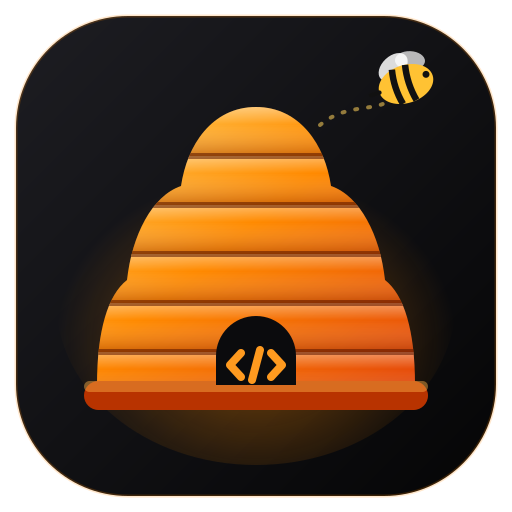
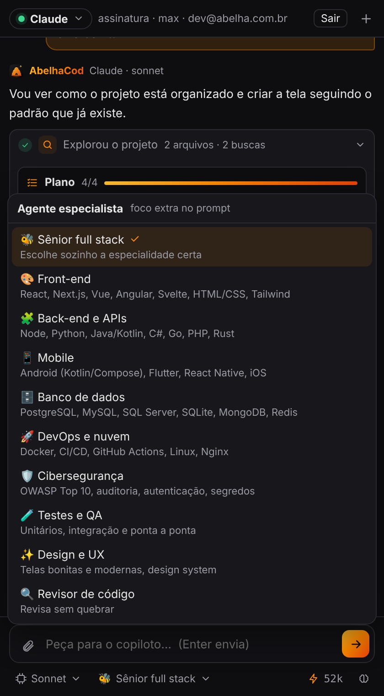
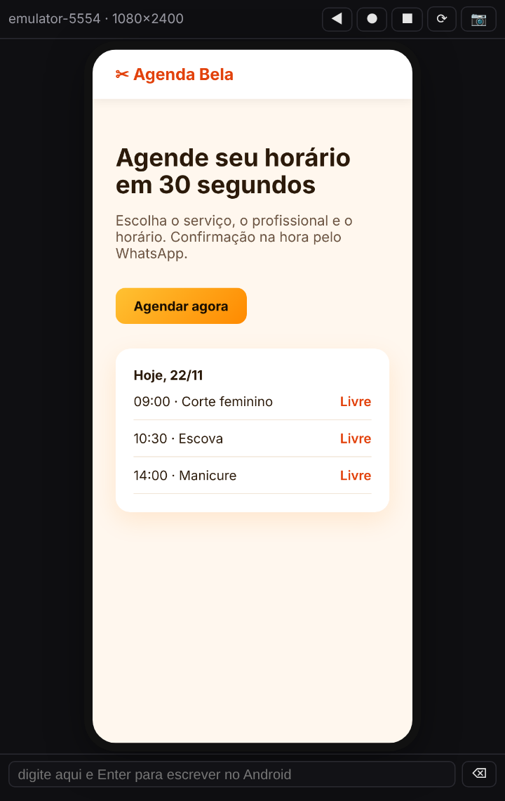

<h1 align="center">AbelhaCod</h1>

<b>O editor de código com inteligência artificial que programa junto com você — e você vê tudo acontecendo ao vivo.</b> 
Claude · Gemini · Grok · Meta AI · IAs grátis — em português, para Windows e Mac

Desenvolvido por <b>Othon Righetti</b> · CEO <b>ABELHA SOLUÇÕES</b> · CNPJ 50.891.115/0001-91

## ⬇️ Baixar

Vá em **[Releases › última versão](../../releases/latest)** e baixe o arquivo do seu computador:

| Seu computador | Baixe |
|---|---|
| **Windows 10 / 11** | `AbelhaCodSetup-x64-<versão>.exe` — instalador (recomendado) |
| Windows sem instalar (portátil) | `AbelhaCod-win32-x64-<versão>.zip` |
| **Mac com chip Apple (M1, M2, M3, M4)** | `AbelhaCod-macOS-arm64-<versão>.dmg` |
| **Mac com processador Intel** | `AbelhaCod-macOS-x64-<versão>.dmg` |

### 🍎 No MacBook (macOS), em 4 passos

1. **Qual baixar:** menu  › *Sobre este Mac*. Se aparecer "Chip Apple M1–M4", baixe o **arm64**; se aparecer "Intel", o **x64**.
2. Abra o `.dmg` e **arraste o AbelhaCod para Aplicativos**.
3. **Primeira vez:** abra o AbelhaCod e clique em **OK** no aviso. Vá em **Ajustes do Sistema › Privacidade e Segurança**, clique em **Abrir Mesmo Assim** e confirme com a senha. No macOS 14 ou anterior: botão direito no app › **Abrir** › **Abrir**.
4. Se aparecer **"está danificado"**, abra o Terminal e rode `xattr -dr com.apple.quarantine /Applications/AbelhaCod.app`.

👉 **Passo a passo completo, com atualização e desinstalação: [INSTALAR-MAC.md](INSTALAR-MAC.md)**

> O AbelhaCod roda no macOS (MacBook, iMac, Mac mini), não em iPhone/iPad.

 

## ✨ O que o AbelhaCod faz

**Uma IA que trabalha de verdade no seu projeto**
- Cria telas, páginas, APIs e apps completos; corrige bugs; explica código; escreve testes — direto nos seus arquivos.
- Você escolhe a IA: **Claude** (pela sua assinatura), **Gemini** (conta Google), **Grok**, **Meta AI** — ou o **Chat Grátis**, que funciona sem pagar nada.
- Escolha também o **modelo** (do mais rápido ao mais inteligente) direto no chat.

**Você acompanha tudo ao vivo**
- O arquivo que a IA está editando abre na sua frente, com as linhas novas destacadas.
- Abriu uma aba sua? A IA não mexe mais na sua tela. Terminou? As abas dela fecham sozinhas.
- No chat, cada passo aparece organizado: arquivos lidos, edições com o que entrou e saiu, comandos com o resultado e o plano da tarefa.

**Chatbots para WhatsApp e Telegram, de arrastar e soltar**
- Monte o atendimento em blocos: mensagens, perguntas, opções, condições, chamadas de API, atendente humano e **IA humanizada** que conversa com base no que você ensinar sobre a empresa.
- WhatsApp pela **API oficial da Meta** (botões e listas) ou pela **GoAPI** (texto e mídia — use com responsabilidade e respeite o limite de mensagens por dia para evitar bloqueio do número), e **Telegram**.
- Teste no **simulador** dentro do editor e gere o servidor pronto para subir no seu VPS com Docker.

**16 agentes especialistas**
Sênior full stack, front-end, back-end e APIs, mobile (Android, Flutter, iOS), banco de dados, DevOps e nuvem, cibersegurança, testes, design e UX, dados e IA, jogos, revisor de código e o **modo Brasil**: Pix e pagamentos, NF-e e fiscal, LGPD e WhatsApp.

**Segurança e controle**
- Antes de instalar algo ou rodar um comando fora da rotina, o AbelhaCod mostra **o que vai acontecer e se é perigoso** — você decide.
- **Desfazer tudo:** antes de cada pedido é salvo um ponto de restauração; volte no tempo com um clique.
- **Memória do projeto:** a IA lembra o que já foi feito e não estraga o que já funciona.
- **Varredura de segurança** do projeto (senhas no código, injeção de SQL, XSS e mais) com correção automática.

**Android e Play Store**
- Do pedido ("faz um app de agendamento") ao app rodando no emulador **dentro do AbelhaCod**, ou no seu celular por cabo ou Wi-Fi.
- Se o app travar, a IA recebe o erro e o print da tela, corrige e testa de novo.
- **AAB assinado** com a chave guardada no cofre do sistema (com backup), checagem do que reprova na loja e **publicação na Play Store** sem sair do editor.

**Do zero ao ar**
- **Novo projeto a partir de modelos:** site, landing page, CRM, automação de WhatsApp, API Node/Laravel, painel administrativo e app Flutter.
- **Publicar em 1 clique** no seu VPS (inclusive Hostinger), na Vercel ou na Netlify.
- **Explorador de banco de dados** (SQLite, PostgreSQL, MySQL) com confirmação antes de qualquer alteração.

**Produtividade**
- **Ctrl+I:** selecione um trecho, diga o que mudar e a IA edita só ali; depois **revise o antes e depois** de cada arquivo e mantenha ou desfaça.
- **Autocompletar com IA** enquanto você digita.
- Chat com **/comandos**, **@arquivo**, várias conversas e regras do projeto (AGENTS.md, CLAUDE.md, .cursorrules).
- **Mensagem de commit escrita pela IA** e **terminal que oferece corrigir** quando um comando falha.
- **Corrigir até passar:** roda os testes, a IA corrige, roda de novo… até dar certo.
- **Preview ao vivo** ao lado do código e **testar no navegador** com um atalho.
- **Uso de tokens** sempre visível, com dicas para economizar.
- **Git sem dor de cabeça:** diagnóstico que encontra e corrige problemas de conexão e login.
- Cole **prints** direto no chat, tema **claro e escuro**, tutorial com imagens na primeira abertura.

**Chat Grátis**
Várias IAs gratuitas já integradas. Se uma estiver ocupada, o AbelhaCod passa para a próxima sozinho, sem perder a conversa.

 

 

## ⌨️ Atalhos

| Atalho | O que faz |
|---|---|
| `Ctrl+Alt+A` | Abrir o Copiloto |
| `Ctrl+Alt+G` | Abrir o Chat Grátis |
| `Ctrl+Alt+I` | Trocar de IA |
| `Ctrl+Alt+S` | Salvar um ponto de restauração |
| `Ctrl+Alt+Z` | Desfazer o que a IA fez (voltar a um ponto) |
| `Ctrl+Alt+R` | Testar no navegador |
| `Ctrl+Alt+F` | Corrigir até passar |
| `Ctrl+Alt+V` | Varredura de segurança |
| `Ctrl+Alt+W` | Preview ao vivo |
| `Ctrl+Alt+D` | Testar no Android e corrigir sozinho |
| `Ctrl+Alt+T` | Tema claro / escuro |
| `Ctrl+I` | Editar o trecho selecionado com IA |
| `Tab` | Aceitar a sugestão do autocompletar |

No Mac, use `Cmd` no lugar de `Ctrl`.

---

### 💬 Suporte

Alguma IA ou modelo falhou, deu erro ou travou? **Fale com a gente: (85) 98414-6479 — Suporte AbelhaCod.**
Dica: no **Chat Grátis**, o botão **Testar** confere do seu computador quais IAs estão respondendo agora; o modo **Automático** passa a evitar as que falharem.

Contribua com o projeto doando qualquer valor via pix para manter as **atualizações e suporte** que são **gratuitos**
- Tipo de Chave: **CNPJ**
- Chave: **50.891.115/0001-91**

© 2026 Othon Righetti — ABELHA SOLUÇÕES (CNPJ 50.891.115/0001-91). Todos os direitos reservados.
Os instaladores são gratuitos para uso. O código-fonte do AbelhaCod não é público. Baseado no Code - OSS (licença MIT, Microsoft).
