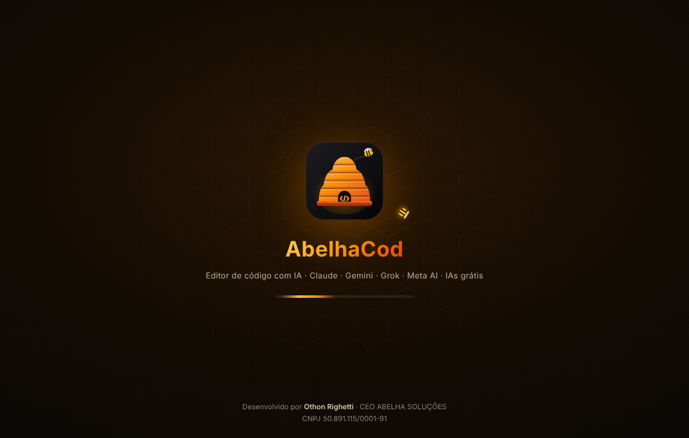
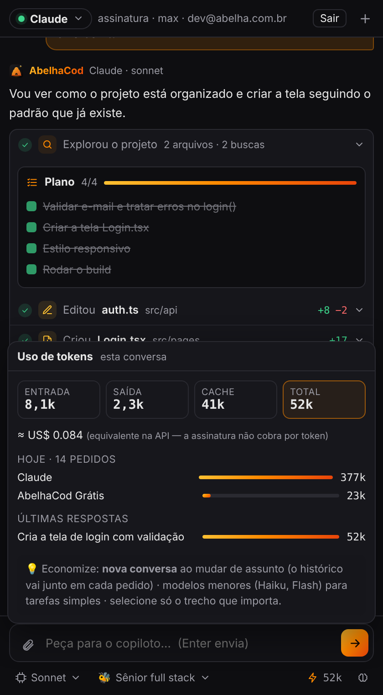

<h1 align="center">AbelhaCod</h1>

<b>O editor de código com IA que programa com você — ao vivo.</b> 
Claude · Gemini · Grok · Meta AI · IAs grátis

Desenvolvido por <b>Othon Righetti</b> · CEO <b>ABELHA SOLUÇÕES</b> · CNPJ 50.891.115/0001-91

## ⬇️ Baixar

Vá em **[Releases › última versão](../../releases/latest)** e baixe o arquivo do seu computador:

| Sistema | Arquivo |
|---|---|
| **Windows 10/11** | `AbelhaCodSetup-x64-<versão>.exe` (instalador) — ou o `.zip` portátil |
| **Mac com chip Apple (M1, M2, M3, M4)** | `AbelhaCod-macOS-arm64-<versão>.dmg` |
| **Mac com Intel** | `AbelhaCod-macOS-x64-<versão>.dmg` |

**Mac:** arraste o AbelhaCod para *Aplicativos*. Na primeira vez, abra **Ajustes do Sistema › Privacidade e Segurança › Abrir Mesmo Assim**
(ou rode no Terminal `xattr -dr com.apple.quarantine /Applications/AbelhaCod.app`).

## ✨ O que ele faz

 

- **IA que trabalha no seu projeto:** cria telas, corrige bugs, roda testes e build — você vê cada arquivo sendo editado, **ao vivo**, com as linhas novas destacadas.
- **Várias IAs, você escolhe:** Claude (pela sua assinatura), Gemini (conta Google), Grok, Meta AI — ou o **Chat Grátis**, que funciona sem pagar nada.
- **Agentes especialistas:** front-end, back-end, mobile, banco de dados, DevOps, cibersegurança, testes, design, dados/IA, jogos e revisor.
- **Conversa clara:** cada leitura, edição (com `+/−` e diferenças), comando (com a saída) e plano aparecem organizados.
- **Autorização explicada:** antes de instalar algo ou rodar um comando fora da rotina, você vê o que vai acontecer e se é perigoso.
- **Memória do projeto:** a IA lembra o que já foi feito e não estraga o que funciona.
- **Desfazer tudo:** pontos de restauração automáticos antes de cada pedido.
- **Corrigir até passar**, **testar no navegador**, **varredura de segurança**, diagnóstico do **Git**, tema claro e escuro.
- **Uso de tokens** visível e prompts econômicos.

 

---

© 2026 Othon Righetti — ABELHA SOLUÇÕES (CNPJ 50.891.115/0001-91). Todos os direitos reservados.
Os instaladores são distribuídos gratuitamente para uso; o código-fonte do AbelhaCod não é público.
Baseado no Code - OSS (licença MIT, Microsoft).
